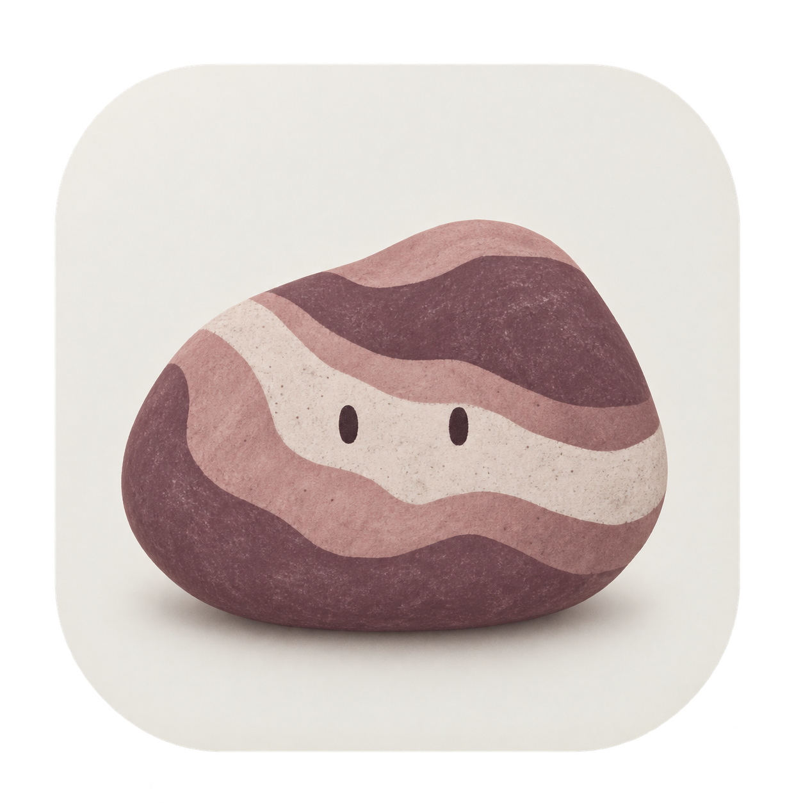

# Pebble Wallpaper · 鹅卵石

Pebble Wallpaper 是一款 Mac 动态壁纸应用。桌面上有一颗慢慢转动的鹅卵石。有的带条纹，有的还长着一张小脸。

[下载 Pebble Wallpaper](https://github.com/DEPYKUNG/pebble-wallpaper-releases/releases/latest)

适用于 macOS 13 或更新版本。打开应用后，从菜单栏的鹅卵石图标进入设置。

## 玩这颗石头

- **换一颗。** 点击桌面右下角的「重新抛」，或从菜单栏找回上一颗。
- **调成喜欢的样子。** 挑选颜色、纹路和背景，决定要不要给石头一张脸。也可以调慢转速、改变倾斜角度，或让它停下来。
- **把喜欢的留下。** 在「设置 → 收藏」里收好当前的石头，随时换回来。也可以把它设成静态壁纸，或存成图片给 Mac 和 iPhone 用。
- **让石头陪着你。** 从「状态栏 → 桌宠」或「设置 → 通用 → 石头桌宠」开启。点一下打招呼，拖动后松手可轻抛；右键可改变大小、同步石头、收回或收起。关闭「自由活动」即可安静陪伴。
- **看看石头证。** 在设置里打开「石头证」，可以看到一颗石头和它的编号。

## 致谢

致敬镇长创作的网页作品《鹅卵石》。Pebble Wallpaper 把原作里「重新抛一颗」的乐趣带到了 Mac 桌面。 [体验原作《鹅卵石》](https://painted-pebble.vercel.app/)

感谢稚笔字体的创作者分享这款开源字体。 [稚笔字样册](https://www.zhibi.fun/#specimen-book)

感谢 Kubai Icons 的作者和贡献者，应用的设置图标来自他们的作品。 [Kubai Icons](https://github.com/kubai087/kubai-icons)
